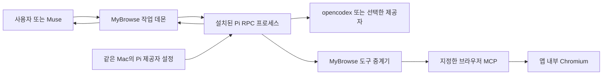

# MyBrowse의 Pi 런타임과 제공자 설정 공유

사용자는 2026-10-14에 Pi의 제공자 연결을 앱에서도 사용하도록 제안했습니다.
이 결정은 Pi를 독립 실행기로 추가합니다.
기존 Codex와 Claude 직접 실행 경로도 유지합니다.
한 작업에는 한 실행기만 사용합니다.
Pi가 실행 중이면, Pi가 다음 행동을 판단합니다.
MyBrowse 데몬은 작업 기록과 브라우저 도구의 실행 경계를 관리합니다.

## 확인한 사실

현재 Mac에는 `@earendil-works/pi-coding-agent` 0.87.1이 설치돼 있습니다.
패키지는 Node 22.19 이상을 요구합니다.
현재 앱 데몬은 Node 24.15 이상을 요구합니다.
Pi의 CLI는 JSONL 기반 RPC 모드를 제공합니다.
Pi는 기본적으로 `~/.pi/agent/models.json`과 `auth.json`을 사용합니다.
`PI_CODING_AGENT_DIR`를 지정하면 같은 경로 선택을 따릅니다.
opencodex 2.82.0의 Pi 통합도 이 경로 선택을 따릅니다.

첨부한 화면에서 Pi 통합은 ‘미적용’으로 표시됩니다.
화면만으로 실제 파일이나 제공자 연결을 완료했다고 판단하지 않습니다.
이 조사에서는 실제 인증 파일과 제공자 비밀 값을 읽지 않았습니다.

조사한 pi-gui 소스는 Pi SDK `^1.0.0`에 의존합니다.
현재 설치된 Pi 0.87.1과 SDK 호환을 가정하지 않습니다.
pi-gui의 화면과 연결 설계는 필요한 범위에서 차용합니다.
Electron 셸은 Chromium 브라우저를 대신하지 않습니다.

## 연결 구조

Pi의 모델 연결과 MyBrowse의 브라우저 연결은 각각 관리합니다.
모델 제공자 설정을 가져와도, MCP 연결이 자동으로 완성되지는 않습니다.
브라우저 도구는 MyBrowse 프로필과 현재 작업에 연결합니다.
각 Mac은 해당 Mac의 Pi 설정과 인증을 사용합니다.
두 Mac 사이에 OAuth 토큰을 자동 복사하지 않습니다.

## 런타임과 설정

앱은 Pi SDK를 직접 수정하거나 고정 SDK를 브라우저 코드에 묶지 않습니다.
첫 연결 때 사용자가 설치한 Pi 실행 파일을 등록합니다.
앱은 절대 경로, 소유자, 패키지 버전과 Node 조건을 검사합니다.
앱 시작과 새 작업 시작 전에 등록된 경로를 다시 확인합니다.
셸 문자열 실행이나 임의 제공자 명령으로 실행 파일을 찾지 않습니다.

앱은 등록한 Pi 버전의 런타임으로 RPC 자식 프로세스를 실행합니다.
실행 중인 작업을 보호하려고, 검증한 런타임을 버전별 캐시에 보관합니다.
캐시는 해당 버전의 실행 파일, 필요한 의존성과 자원을 포함합니다.
외부 파일 교체가 캐시의 실행에 영향을 주지 않는지 검사합니다.
캐시 manifest에 실행 파일과 필요한 자원의 SHA-256을 기록합니다.
설치 중 파일이 바뀌면, 캐시를 활성화하지 않고 다시 검사합니다.
실행 전에는 캐시 manifest와 파일 해시를 확인합니다.
실행 중인 작업이 참조하는 캐시는 정리하지 않습니다.
이전 비활성 버전은 두 개까지 보관합니다.
캐시 정리는 앱이 만든 경로와 manifest에 기록한 파일에만 적용합니다.
사용자가 수정한 캐시 파일은 자동 삭제하지 않습니다.
이는 설치된 Pi 업데이트를 반영하는 실행 캐시이며 별도 SDK 포크가 아닙니다.
Pi 제공자 설정과 인증은 캐시에 복사하지 않습니다.
세션과 작업 기록은 `--session-dir`로 MyBrowse 전용 폴더에 저장합니다.
제공자 설정과 인증은 해당 Mac의 기존 Pi 저장소를 사용합니다.
MyBrowse는 인증 값을 renderer, Muse, 로그와 명령행 인수에 전달하지 않습니다.
OAuth 갱신은 Pi가 공식 인증 저장소에서 처리합니다.
MyBrowse는 `auth.json`과 opencodex 관리 블록을 직접 덮어쓰지 않습니다.
Pi 자식 프로세스의 정상적인 인증 갱신과 설정 저장은 허용합니다.
Pi는 자체 파일 잠금으로 인증과 설정 쓰기를 조정합니다.
현재 설치 패키지에서 `auth-storage.js`와 `settings-manager.js`의 잠금을 확인했습니다.
TUI Pi와 앱을 동시에 실행하는 실제 검사는 아직 하지 않았습니다.
MyBrowse는 opencodex가 관리하는 모델 파일을 직접 수정하지 않습니다.
설정 파일 변경 중 읽기가 실패하면, 기존 선택을 보존하고 새 작업을 대기시킵니다.

설정 화면은 Pi가 반환하는 제공자명, 모델명과 연결 상태만 표시합니다.
백엔드는 이 표시 필드를 골라서 반환합니다.
Pi가 반환한 전체 모델 객체, 헤더와 base URL을 renderer에 전달하지 않습니다.
일반 설정은 지원되는 Pi 연결부를 통해 변경합니다.
opencodex 연결 적용은 opencodex의 관리 기능을 사용합니다.
제공자 파일을 별도 사본으로 가져오는 방식은 기본 경로로 사용하지 않습니다.

프로젝트 확장과 일반 파일·셸 도구는 브라우저 작업에 자동으로 추가하지 않습니다.
MyBrowse가 검증한 브라우저 연결 확장만 명시적으로 로드합니다.
제공자가 별도 확장을 요구하면, 해당 제공자 연결을 개별 검증합니다.
미지원 연결은 이유를 표시하고 작업을 시작하지 않습니다.

## 업데이트와 재개

사용자가 Pi를 업데이트하면, 다음 새 작업은 업데이트된 버전의 캐시를 검사합니다.
진행 중인 Pi 프로세스와 제공자를 중간에 바꾸지 않습니다.
실행 전에 RPC 명령, 이벤트와 도구 경계의 호환성을 검사합니다.
초기 검사는 별도 임시 agent directory에서 실행합니다.
검사에는 `PI_OFFLINE=1`을 적용하고 실제 인증 저장소를 사용하지 않습니다.
도구, 확장, 스킬, 프롬프트 템플릿과 테마를 비활성화합니다.
검사는 모델 요청이나 브라우저 조작 없이 먼저 실행합니다.
지원되는 버전이면, 기존 Pi 설정으로 연결합니다.
지원되지 않는 버전이면, `waiting_provider`로 멈추고 호환 이유를 표시합니다.
검증되지 않은 버전이나 유료 제공자로 자동 전환하지 않습니다.

Pi 제공자 설정이 바뀌면, 다음 작업 또는 명시적 새로고침에서 목록과 연결 상태를 반영합니다.
새 제공자가 나타나도 기존 선택한 모델을 임의로 바꾸지 않습니다.
앱은 Pi 제공자 설정을 별도 입력 양식으로 다시 요구하지 않습니다.
선택한 제공자가 사라지면, 해당 작업은 제공자 대기로 멈춥니다.
진행 중인 작업의 모델은 해당 작업에 기록한 값을 유지합니다.
작업에는 실제 Pi 세션 ID, Pi 버전, 제공자와 모델을 기록합니다.
재개 전에 새 Pi가 저장된 세션 형식을 읽는지 검사합니다.
재개 시 제공자 변경이 필요하면, 변경 사실을 사용자에게 표시합니다.
새 엔진이 이전 대화 이력을 자동 승계한다고 가정하지 않습니다.

앱은 Pi를 확인 없이 전역 업데이트하거나 별도 Pi 사본을 설치하지 않습니다.
앱의 Chromium 보안 업데이트는 Pi 업데이트와 별도 경로로 관리합니다.

## 호환 판정 계약

필수 RPC 명령은 `get_state`, `get_commands`, `get_available_models`입니다.
응답에는 요청 ID, `command`, `success`와 해당 명령의 데이터가 있어야 합니다.
입력 EOF 뒤에는 Pi가 정상 종료해야 합니다.
0.87.1은 시작 계약과 로컬 시험 제공자의 실행 계약을 실제 검사에서 통과했습니다.
모델 실행을 허용한 Pi 버전 목록은 현재 비어 있습니다.

실행 인증에는 `prompt`, `abort`, `steer`와 실제 session ID 검사를 추가합니다.
정상 완료는 `agent_settled`로 판단합니다.
메시지 갱신, 도구 요청과 오류 이벤트의 구조도 검사합니다.
모델 호출과 도구 처리는 로컬 가짜 제공자로 먼저 검증합니다.
가짜 제공자 검사는 실제 LLM 왕복과 구분합니다.
이후 명시적으로 선택한 실제 제공자를 확인합니다.
지원하지 않는 명령과 이벤트는 실행 허용 목록에 추가하지 않습니다.
시작 계약, 가짜 제공자 실행, 취소·개입과 세션 검사가 모두 통과해야 실행을 허용합니다.
자동 업데이트 반영은 이 조건을 통과하고 기존 선택한 제공자를 유지할 때만 허용합니다.
지원하지 않는 계약이면, 현재 검증된 버전을 유지하고 호환 대기를 표시합니다.

현재 소스에서 `get_available_models`는 메모리에 있는 목록을 반환합니다.
Pi 시작 전체가 실제 인증 파일을 건드리지 않는다고 단정하지 않습니다.
그래서 시작 계약 검사는 별도 agent directory에서 실행합니다.
pi-gui 차용 코드가 고정 Pi SDK 타입을 직접 가져오지 않는지도 검사합니다.
계획의 선호 실행기는 Pi입니다. Pi 실행기 파일과 로컬 시험 제공자 왕복은 검증했습니다.
현재 서비스에 등록된 실행기는 Codex와 Claude입니다.
Pi 등록과 공유 런타임 활성화는 남은 수락 기준을 통과한 뒤 처리합니다.

## 수락 기준

| 검사 | 통과 기준 |
|---|---|
| 같은 설정 | Pi와 앱에서 동일한 제공자·모델을 선택할 수 있습니다. |
| opencodex 적용 | Pi 통합 적용 뒤 앱에서도 해당 제공자가 나타납니다. |
| 업데이트 | Pi 업데이트 뒤 다음 작업이 새 버전을 사용합니다. |
| 호환 거부 | 지원하지 않는 RPC에서는 모델 요청 전에 멈춥니다. |
| 실행 중 유지 | 업데이트 중 기존 작업의 엔진과 모델이 바뀌지 않습니다. |
| 런타임 교체 | 기존 Pi 파일을 교체해도 캐시의 진행 작업이 영향을 받지 않습니다. |
| 공유 파일 잠금 | TUI Pi와 앱의 동시 인증·설정 변경이 값을 훼손하지 않습니다. |
| 세션 재개 | 새 Pi가 MyBrowse 전용 세션을 읽거나 명확한 호환 오류를 반환합니다. |
| 캐시 경계 | 파일 해시가 맞고, 인증·모델 설정·사용자 세션이 캐시에 복사되지 않습니다. |
| 실제 저장소 | 첫 실제 연결에서 공유 파일의 변경 여부를 비밀 값 출력 없이 확인합니다. |
| 인증 | 실제 연결 검사에서도 비밀 값이 UI와 로그에 나오지 않습니다. |
| 두 Mac | 각 Mac의 실제 Pi와 브라우저 도구 왕복을 확인합니다. |

현재 Pi 런타임과 제공자 공유는 계획 단계입니다.
0.87.1의 오프라인 시작 RPC를 실제 확인했습니다.
로컬 시험 제공자로 응답, 완료 경계, 같은 세션 재개와 중간 지시를 확인했습니다.
대기 지시 제거와 취소 및 EOF 종료도 확인했습니다.
검사에서는 별도 agent directory를 사용했고 실제 인증 값을 읽지 않았습니다.
런타임 캐시와 실제 제공자 및 브라우저 도구 통합은 아직 확인하지 않았습니다.
실제 Pi 모델 왕복과 opencodex의 Pi 적용은 아직 하지 않았습니다.
기존 Codex·Claude 대화 검사와 Chromium 컴파일은 계속 유효합니다.

## 출처

- [Pi RPC](https://github.com/earendil-works/pi/blob/main/packages/coding-agent/docs/rpc.md)는 프로세스 분리와 JSONL 계약을 설명합니다.
- [Pi 설정](https://github.com/earendil-works/pi/blob/main/packages/coding-agent/docs/configuration.md)은 공유 설정 경로를 설명합니다.
- [Pi 모델 연결](https://github.com/earendil-works/pi/blob/main/packages/coding-agent/docs/models.md)은 제공자 설정과 모델 목록 갱신을 설명합니다.
- [opencodex 통합 경로](https://github.com/lidge-jun/opencodex/blob/main/src/integrations/registry.ts)는 Pi 경로 선택을 제공합니다.
- [pi-gui 기준 패키지](https://github.com/minghinmatthewlam/pi-gui/blob/572c0c6de8ffd3a245c224b912bb8752ca200780/apps/desktop/package.json)는 SDK 의존성을 제공합니다.

로컬 설치 패키지의 package.json, cli --help와 공개 구현 파일을 함께 확인했습니다.
