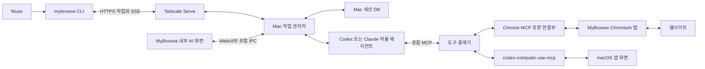

# mybrowse 통합 Chromium 앱과 자율 에이전트 계획

웹페이지와 AI 대화를 `MyBrowse.app` 안에 함께 표시한다. 좌측에는 북마크, 대화와 브라우저 탭을 둔다. 중앙에는 선택한 웹페이지, 대화 또는 홈 화면을 표시한다. 브라우저 옆의 자율 에이전트가 작업을 판단한다. Muse는 작업을 맡기고 진행 상황과 결과를 받는다.

사용자가 앱 내부 표시를 선택했다. 화면 위치 질문은 해결했다. JSON 상태는 `READY`로 바꾼다. READY는 실행 가능한 계획이라는 뜻이다. 앱 구현, 설치 성공이나 확장 호환 검증 완료를 뜻하지 않는다.

이번 수정은 계획에만 반영했다. 설치, 로그인과 기존 서비스 변경은 하지 않았다. 작업 ID는 `2026-10-13-mybrowse-architecture`이다. iMac과 MacBook을 모두 지원한다.

## 확정한 제품과 화면

1. Chromium 기반의 독립 Mac 앱을 만든다. 웹페이지를 앱 안의 실제 브라우저 탭에서 표시한다.
2. 좌측에 고정 바로가기, 북마크, 대화와 탭을 둔다. 에이전트가 사용하는 탭은 그룹과 상태로 구분한다.
3. 홈에는 Search/Ask 입력과 최근 작업을 둔다. 대화를 열면 메시지, 도구 실행과 결과를 표시한다.
4. 설치된 Pi의 자율 실행과 제공자 설정을 공유한다. Codex·Claude 직접 실행도 유지한다.
5. 지정한 두 MCP 어댑터를 연결한다. Chrome Web Store와 Bitwarden 설치를 필수 검증에 넣는다.

첨부 이미지에서 확인한 요소는 좌측 바로가기·북마크·Chats·Tabs와 중앙 Search/Ask·Recent tasks이다. 스크린샷은 화면 참고 자료이다. Aside 내부 코드와 통신 구조를 입증하는 자료로 사용하지 않는다.

| 영역 | 사용자 행동과 결과 |
| --- | --- |
| 좌측 바로가기와 북마크 | 선택한 사이트를 앱 내부 탭에서 연다. |
| 좌측 대화 목록 | 대화를 선택하면 중앙에서 이어서 말한다. 새 대화와 최근 작업을 찾을 수 있다. |
| 좌측 브라우저 탭 | 실제 열린 탭을 선택·정리한다. 작업과 연결된 탭을 표시한다. |
| 중앙 홈 | 주소 탐색, 검색과 AI 요청을 구분한다. 최근 작업 카드에서 결과를 다시 연다. |
| 중앙 웹페이지와 대화 | 같은 앱에서 전환한다. 웹 탐색 중에는 대화 패널을 함께 열 수 있게 한다. |

일반 웹사이트는 Chromium의 실제 `WebContents`에서 표시한다. 외부 사이트를 iframe으로 넣는 방식은 사용하지 않는다. 탭 목록은 Chromium 탭 모델과 연결한다. 목록이 바뀌어도 작업 대상 탭을 혼동하지 않아야 한다.

브라우저 탭 닫기와 대화 삭제는 다른 동작이다. 대화 기록은 탭을 닫아도 남긴다. 작업을 중단할 때도 결과 탭을 자동 삭제하지 않는다.

## 브라우저 기반과 pi-gui 차용

전체 브라우저는 Chromium의 `chrome` 타깃을 기반으로 만든다. 탭, 주소창, 설정, 다운로드와 확장 관리 기능을 유지한다. 앱 이름, 번들 ID와 데이터 경로를 분리한다. Chromium 상류 버전과 최소 패치 목록을 고정한다.

`pi-gui`의 AI 화면과 연결 설계를 재사용 후보로 채택한다. 확인한 커밋은 `572c0c6de8ffd3a245c224b912bb8752ca200780`이다. 앱 버전은 `1.0.1`, Electron 버전은 `37.10.3`이다. 라이선스는 MIT이다. 차용한 소스에는 저작권과 라이선스 고지를 보존한다.

다음 구현은 소스에서 확인했다. 제공자가 로그인되거나 MCP 서버가 실제로 연결된 상태를 시험한 것은 아니다.

| 재사용 후보 | 확인한 소스와 조건 |
| --- | --- |
| 대화 입력과 스트리밍 화면 | `apps/desktop/src/features/conversation/`에 입력, 메시지와 도구 결과 화면이 있다. |
| 대화 목록과 선택 | `apps/desktop/src/features/threads/sidebar.tsx`와 스레드 기능을 브라우저 화면에 맞게 줄인다. |
| LLM 제공자와 OAuth 화면 | `settings-providers-section.tsx`와 `RuntimeSupervisor.login()`이 있다. 실제 인증은 Pi 런타임이 맡는다. |
| MCP 서버 관리 | `settings-mcp-section.tsx`, `mcp-config.ts`와 `createMcpExtension()` 연결이 있다. |
| 실행기 계약과 이벤트 | `packages/session-driver`에 메시지 전송, 구독, 중단과 모델 선택 계약이 있다. |

pi-gui의 최종 브라우저 역할을 Electron에 맡기지 않는다. Electron은 임의 Chrome Web Store 확장과 완전한 호환을 지원하지 않는다. 사용자 요구에 필요한 확장 설치를 Electron 웹뷰만으로 충족했다고 표현하지 않는다. [Electron 확장 지원](https://www.electronjs.org/docs/latest/api/extensions)

브라우저 안의 AI 화면은 Chromium 내부 WebUI로 연결하는 경로를 우선 검증한다. pi-gui의 React 화면을 브라우저용으로 묶고 IPC 연결부를 교체한다. 내부 화면 후보 주소는 `chrome://mybrowse/`이다. 일반 웹페이지에는 앱의 특권 연결을 제공하지 않는다. [Chromium WebUI](https://github.com/chromium/chromium/blob/main/docs/webui/webui_explainer.md)

Node 기반 실행기는 앱에 포함한 로컬 보조 프로세스로 둔다. Chromium C++ 코드 안에 모델 호출 루프를 새로 작성하지 않는다. AI 화면은 제한된 브라우저 연결부를 통해 작업 관리자와 통신한다.

`window.piApp`와 Electron preload는 Chromium에서 그대로 동작하지 않는다. `MyBrowseBridge`에 대응하는 typed 계약을 만들고 WebUI의 Mojo 연결과 로컬 IPC로 이어준다. Electron 전용 알림·파일·창 처리는 필요한 기능만 Mac 브라우저 서비스로 이식한다.

설치된 Pi를 RPC 어댑터로 연결한다. Pi가 작업의 판단 루프를 실행한다. pi-gui의 고정 SDK를 그대로 묶지 않는다. 현재 설치된 Pi 0.87.1과 pi-gui가 요구하는 SDK ^1.0.0은 호환 검사가 필요하다. 한 작업에 Pi와 CLI의 판단 루프를 중첩하지 않는다.

제공자 화면은 해당 Mac의 Pi 설정과 연결 상태를 표시한다. opencodex의 Pi 통합을 적용하면 같은 제공자를 앱에서도 선택한다. Pi 인증이 Codex·Claude 직접 실행 인증으로 자동 공유된다고 가정하지 않는다. MyBrowse 브라우저 MCP는 별도로 연결하고 검증한다.

첫 버전에서는 Git worktree, 코드 리뷰와 터미널 작업 화면을 옮기지 않는다. 브라우저 프로필과 대화 작업에 필요한 화면만 차용한다. [pi-gui 구조와 라이선스](https://github.com/minghinmatthewlam/pi-gui/tree/572c0c6de8ffd3a245c224b912bb8752ca200780)

## 모델 실행기와 계정

| 실행 경로 | 로그인과 비용 조건 | 연결 방식 |
| --- | --- | --- |
| Codex CLI | `codex login`으로 ChatGPT 계정에 로그인한다. 해당 구독의 사용량과 제한이 적용된다. | 로컬 `codex app-server`의 stdio 연결을 기본으로 검증한다. |
| Claude Code | Claude 구독 계정으로 별도 로그인한다. ChatGPT Pro는 Claude 사용 권한을 제공하지 않는다. | CLI의 비대화형 실행과 구조화된 진행 출력을 연결한다. |
| 설치된 Pi | 기존 Pi 제공자 설정과 인증을 사용한다. 선택한 제공자의 사용 조건을 따른다. | 버전 호환을 확인한 뒤 Pi RPC를 호출한다. |
| Pi + opencodex | Pi 통합을 적용한 제공자의 로그인과 사용 조건을 따른다. | 같은 Pi 설정을 사용하며 별도 인증 사본을 만들지 않는다. |

추가 API 과금을 피하는 설정을 기본으로 한다. API 키 연결과 유료 경로 자동 전환을 켜지 않는다. opencodex의 대체 경로와 보조 기능도 검사한다. 인증이나 구독 한도에 문제가 생기면 멈추고 이유를 표시한다.

OAuth라는 이름만으로 모든 제공자를 무료로 쓸 수 있는 것은 아니다. Claude에는 사용 가능한 별도 구독이 필요하다. Codex도 구독 한도와 계정 권한을 따른다. [Codex 인증](https://learn.chatgpt.com/docs/auth), [Claude 인증](https://code.claude.com/docs/en/authentication), [opencodex](https://github.com/lidge-jun/opencodex)

각 실행기는 공식 로그인 저장소를 사용한다. 앱은 토큰을 추출하거나 Muse VM에 복사하지 않는다. 앱 전용 작업 디렉터리를 사용한다. 사용자 전역 설정을 덮어쓰지 않는 연결 방법은 초기 검증에서 확인한다.

Claude의 현재 문서는 `--bare`에서 구독 OAuth를 읽지 않는다고 설명한다. 구독 실행에는 해당 옵션을 무조건 붙이지 않는다. MCP와 도구 설정을 명시하고 구독 인증 유지 여부를 확인한다. [Claude CLI 실행](https://code.claude.com/docs/en/headless)

현재 컴퓨터에서 확인한 버전은 Codex CLI `0.162.1`, Claude Code `2.1.296`, opencodex `2.82.0`이다. 설치 여부를 확인했으며 로그인 성공과 모델 실행은 검사하지 않았다. 두 Mac의 실제 설치 상태는 별도 확인이 필요하다.

## 통신 구조



Mac 작업 관리자는 지시와 이벤트를 저장한다. 다음 행동은 CLI 에이전트가 결정한다. Muse는 매 클릭마다 판단하지 않는다. 로컬 AI 대화와 Muse 요청은 같은 작업 API로 들어온다.

opencodex를 선택하면 모델 연결에 제공자 프록시를 추가한다. 브라우저 도구와 세션 API는 유지한다. 앱은 실제 모델과 제공자를 표시한다.

원격 서버는 loopback에 바인딩한다. Tailscale Serve는 tailnet 전용 HTTPS를 제공한다. 모델 실행기, MCP stdio와 브라우저 CDP는 로컬로 유지한다. Muse VM의 tailnet 접근은 구현 첫 연결에서 확인한다. [Tailscale Serve](https://tailscale.com/docs/features/tailscale-serve)

웹 요청은 새 브라우저에서 사이트로 직접 나간다. 기존 네이버 정책과 전역 요청 차단을 일반 탐색에 붙이지 않는다. 제어 서버 접속 인증과 방문 사이트 정책을 구분한다.

## Muse와 자율 에이전트의 왕복

1. Muse가 호스트와 실행기를 지정하여 `mybrowse exec`를 호출한다.
2. Mac이 작업을 저장하고 자율 에이전트에 지시를 전달한다.
3. 에이전트가 화면 관찰과 MCP 조작을 반복한다.
4. Mac이 진행 이벤트와 결과를 저장하고 Muse에 전달한다.
5. Muse가 결과를 활용하거나 추가 지시로 작업을 재개한다.

Muse는 매 클릭마다 판단하지 않는다. CLI 출력 연결이 끊겨도 Mac 작업 관리자가 실행을 유지한다. Muse는 실제 세션 ID로 다시 접속한다. 결과에는 실제 호스트와 대상 탭을 포함한다.

Codex 연결은 `thread/start` 또는 `thread/resume` 이후 `turn/start`를 사용한다. `turn/steer`는 실행 중인 턴에 지시를 추가한다. 취소는 `turn/interrupt`로 처리한다. 두 명령을 같은 기능으로 취급하지 않는다. [Codex App Server](https://learn.chatgpt.com/docs/app-server)

Claude 연결은 `claude -p`와 `stream-json` 출력을 검증한다. CLI가 반환한 실제 세션 ID를 저장한다. 재개에는 공식 CLI의 기존 세션 이어하기를 사용한다. 실시간 개입 지원은 실행기별로 확인한다.

## 조작 어댑터

### 브라우저 제어

지정한 `codex-control-chrome-mcp`를 기반으로 연결한다. 확인한 버전은 `1.4.1`이다. 기준 커밋은 `c701215a63fc5ca6bdc208deb27417cb7da3cb44`이다. 독립 커뮤니티 프로젝트이다.

현재 소스의 등록 대상은 Chrome과 Edge이다. MyBrowse는 기본 지원 목록에 없다. 앱 내부 브라우저를 선택했으므로 호환 연결 작업을 첫 단계에 포함한다. [현재 지원과 연결 구조](https://github.com/iola1999/codex-control-chrome-mcp)

| 확인 순서 | 검증 내용 |
| --- | --- |
| 확장 설치 | MyBrowse에서 Codex Chrome 확장을 설치하고 실행할 수 있는지 확인한다. |
| 호스트 등록 | MyBrowse의 별도 데이터 경로에 Native Messaging 등록을 추가한다. |
| 연결 식별 | 브리지와 실제 앱·프로필·탭을 연결한다. 기존 Chrome 탭과 혼동하지 않는다. |
| 조작 왕복 | 목록, 탐색, JS, 캡처와 CDP 명령이 새 앱의 탭에서 실행되는지 확인한다. |
| 호환 실패 처리 | MCP 도구 계약을 유지하고 브라우저 연결부만 자체 로컬 브리지로 보완한다. 외부 Chrome으로 자동 전환하지 않는다. |

확인한 기본 경로는 MCP, 로컬 소켓, Native Messaging, Codex Chrome 확장과 `chrome.debugger`이다. 호스트 이름은 `com.openai.codexextension`이다. 공식 확장을 사용하는 동안 호스트 이름을 임의로 바꾸지 않는다.

등록 파일은 MyBrowse가 읽는 경로에 둔다. 기존 Chrome의 manifest를 덮어쓰는 설치를 기본으로 실행하지 않는다. 자동 재등록 대상도 새 앱으로 제한한다. 확장 ID, 호스트 탐색 경로와 브리지 선택을 실제 빌드에서 확인한다.

별도 로컬 브리지가 필요하면 MIT 어댑터의 MCP 프런트엔드를 유지한다. 브라우저 측 전송만 MyBrowse의 제한된 IPC에 연결한다. 세션 제어권과 중단 검사는 동일하게 적용한다. 공개 CDP 포트는 만들지 않는다.

[공식 확장 페이지](https://chromewebstore.google.com/detail/hehggadaopoacecdllhhajmbjkdcmajg), [확인한 MCP 도구](https://github.com/iola1999/codex-control-chrome-mcp/blob/c701215a63fc5ca6bdc208deb27417cb7da3cb44/src/mcp-server.js)

### 컴퓨터 화면 제어

`codex-computer-use-mcp`는 공식 서명된 컴퓨터 조작 구성요소를 연결하는 커뮤니티 프로젝트이다. 확인한 버전은 `0.5.2`이다. 기준 커밋은 `dc72bae614dccd01ef9d0ffd8fdcfd42c990fc78`이다.

Node.js 22 이상, 공식 ChatGPT Mac 앱과 Computer Use 구성요소가 필요하다. 화면 기록과 손쉬운 사용 권한도 확인한다. `codex login`만으로 화면 조작 준비가 끝나지는 않는다.

GUI 세션은 잠금 해제되어 있어야 한다. 새 MyBrowse 앱을 앱 식별자로 찾고 조작하는지 검증한다. 기본 Chrome 이름을 가정하지 않는다. 확장 팝업, 파일 선택창과 브라우저 UI에 활용한다.

컴퓨터 어댑터의 자격증명 없는 app-server와 모델 실행용 app-server는 별개이다. 어댑터에서 모델 턴을 시작하지 않는다. OS 권한과 공식 호스트의 승인 요청은 실행기에 전달한다.

데스크톱 조작에는 Mac 단위의 단일 제어권을 확보한다. 잠금과 권한 오류에서는 `waiting_user`로 멈춘다. [지정한 패키지](https://pi.dev/packages/codex-computer-use-mcp), [구성요소와 서명 조건](https://github.com/tmustier/codex-computer-use-mcp)

## Mac 앱과 Bitwarden

Chrome Web Store를 새 앱의 탭에서 열 수 있게 한다. Bitwarden을 스토어에서 설치하고 정상 업데이트할 수 있어야 한다. 자체 Chromium 빌드의 성공 여부는 초기 시제품에서 확인한다. 단순 압축 해제 확장 로딩을 스토어 호환 완료로 보고하지 않는다.

[Bitwarden 공식 확장](https://chromewebstore.google.com/detail/bitwarden-password-manage/nngceckbapebfimnlniiiahkandclblb)은 필수 검증 대상이다. 설치, 브라우저 재실행, 잠금 해제와 시험 자동 입력을 두 Mac에서 확인한다. [Bitwarden 안내](https://bitwarden.com/help/getting-started-browserext/)

Bitwarden 로그인과 마스터 비밀번호 입력은 사용자가 한다. 시험 계정을 사용한다. 비밀번호 필드, 모델용 관찰, 로그와 캡처의 비밀 값 가림을 확인한다.

새 앱은 별도 Chromium 프로필을 가진다. 기존 Chrome의 로그인 쿠키가 자동으로 승계된다고 약속하지 않는다. 북마크와 필요한 설정은 원본을 보존하며 가져온다. 확장은 선택 목록에 따라 새 앱에서 다시 설치한다.

쿠키와 비밀번호 전체 이전은 첫 버전에 포함하지 않는다. 사이트 로그인은 새 프로필에서 확인한다. Bitwarden은 지원되는 계정 로그인과 동기화로 사용한다. Google Chrome Sync도 기본 제공으로 가정하지 않는다. [Chromium Google API 조건](https://www.chromium.org/developers/how-tos/api-keys/)

## 명령과 API 계약

| 명령 | 의미 |
| --- | --- |
| `mybrowse exec "<작업>" --host imac --engine codex` | 작업을 생성하고 Mac의 자율 에이전트를 실행한다. 진행 이벤트를 출력한다. |
| `mybrowse exec "<작업>" --host macbook --engine claude` | MacBook의 Claude 실행기로 작업을 시작한다. |
| `mybrowse exec "<작업>" --engine codex --router opencodex --provider <이름>` | 제공자 경로를 검증한 뒤 실행한다. |
| `mybrowse session list` / `session log <id> --follow` | 작업 목록과 저장된 진행 이력을 읽는다. |
| `mybrowse session steer <id> "<지시>"` | 우선 지시를 추가한다. 실행기 방식에 따라 중단·재개할 수 있다. |
| `mybrowse session queue <id> "<지시>"` | 현재 턴이 끝난 뒤 전달할 지시를 저장한다. |
| `mybrowse session resume <id> "<지시>"` | 저장한 실행기 세션과 최신 화면으로 이어간다. |
| `mybrowse session stop <id>` | 새 조작을 차단하고 실행기에 중단을 요청한다. |

모든 명령은 `--host imac`과 `--host macbook`을 지원한다. 별칭은 등록된 기기 ID를 가리킨다. 작업은 같은 Mac에서 이어간다. 다른 Mac으로 자동 이동하지 않는다.

`mybrowse repl "<JS>"`과 대화형 REPL은 유지한다. 확인된 MCP 기능 위에 최소 JS API를 제공한다. 전체 Playwright 호환으로 표현하지 않는다. 탭 생성·목록·닫기·활성화와 `shot`도 확인한 기능만 노출한다.

| API | 계약 |
| --- | --- |
| `GET /v1/capabilities` | 호스트, 실행기, 로그인 필요 상태와 지원 범위를 반환한다. |
| `POST /v1/sessions` | 지시, 호스트, 실행기, 제공자와 대상 탭을 저장한다. |
| `POST /v1/sessions/<id>/commands` | steer, queue, stop, resume와 직접 조작을 받는다. |
| `GET /v1/sessions/<id>/events?after_seq=<n>` | 저장된 이벤트와 새 진행 상황을 SSE로 전달한다. |
| `GET /v1/sessions/<id>/result` | 결과, 증거 참조, 호스트와 실제 탭을 반환한다. |

`exec`는 접수 응답으로 세션 ID를 받은 뒤 이벤트를 구독한다. Muse가 장시간 출력을 받을 수 없으면 결과 조회로 이어간다. 중복 접수를 막는 `request_id`를 사용한다.

실행기의 최종 이벤트와 작업 기록으로 성공을 판단한다. 프로세스 종료만으로 완료를 선언하지 않는다. 실패, 중단과 불명확한 결과를 구분한다.

## 세션 제어와 복구

세션 원본은 각 Mac의 SQLite에 둔다. VM에는 접속 설정과 이벤트 커서를 둔다. 실행기 세션 ID는 공식 CLI가 반환한 값만 저장한다.

| 기록 | 주요 내용 |
| --- | --- |
| `sessions` | host_id, profile_binding, engine, provider, engine_session_id, status, revision, step_budget, result |
| `steps` | 도구 요청, 전송 상태, 결과, 관찰 참조와 시각 |
| `commands` | request_id, 지시 버전, 개입 명령과 처리 결과 |
| `events` | 세션별 순번, 진행·도구·상태·결과 이벤트 |
| `control_state` | 탭·데스크톱 제어권, 지시 대기열과 체크포인트 |

상태는 `queued`, `running`, `waiting_user`, `waiting_provider`, `paused`, `done`, `failed`, `uncertain`으로 구분한다. 로그인과 OS 권한에는 `waiting_user`를 사용한다. 제공자 한도와 인증 문제는 사유를 기록한다.

도구 중계기는 조작 직전에 지시 버전과 제어권을 검사한다. 기본 조작 예산은 30회이다. 관찰과 캡처는 조작 횟수와 구분한다. 예산 초과는 `paused`로 처리한다. 완료로 보고하지 않는다.

`steer`는 지시 버전을 올리고 실행기에 새 지시를 전달한다. 이미 전송한 클릭을 취소했다고 보고하지 않는다. Codex의 live steer만으로 도구 중단을 보장하지 않는다. 강한 중단에는 interrupt와 중계기 차단을 함께 사용한다.

`queue`의 기본 경계는 현재 턴 종료 이후로 정한다. 도구별 경계 개입은 실제 실행기 검증 후 별도 capability로 제공한다.

`stop`은 먼저 새 도구를 막는다. 이후 소유한 실행기 턴이나 프로세스를 중단한다. MyBrowse 브라우저와 다른 CLI 세션을 종료하지 않는다. 진행 중인 조작의 확인 가능한 결과를 기록한다.

절전 이후에는 기존 탭을 먼저 찾는다. 탭이 없으면 복구 범위를 알린다. URL 복원만으로 폼과 거래 상태를 복원했다고 보고하지 않는다.

조작 직후 연결이 끊기면 `uncertain`으로 둔다. 최신 화면과 실행 이력을 확인한 뒤 이어간다. 결과가 불명확한 제출 요청을 자동 반복하지 않는다.

Muse 연결 해제와 작업 관리자 종료는 구분한다. 앱을 닫아도 실행을 유지할지는 사용자 설정으로 제공한다. Mac 재부팅 뒤에는 체크포인트로 재개 가능 상태를 표시한다. 이전 클릭 참조를 재사용하지 않는다.

## 제안 폴더와 실행 환경

다음은 새 프로젝트의 제안 경로이다. 현재 제품 소스를 생성한 상태는 아니다.

```text
mybrowse/
  browser/
    chromium.lock.json       # 상류 버전과 커밋
    patches/                 # 브랜드, 탭과 내부 UI 연결
    build/                   # Mac 빌드와 리소스 묶기
  ui/
    shell/                   # 통합 좌측 목록과 홈
    conversation/            # pi-gui에서 선별 이식
    settings/                # 실행기와 MCP 설정
    bridge/                  # Electron IPC를 WebUI 계약으로 교체
  daemon/
    sessions/
    auth/
    transport/
  engines/
    codex/
    claude/
    pi/
  providers/
    opencodex/
  adapters/
    tool-broker/
    chrome/
    computer/
  cli/
  protocol/
  install/macos/
  test/
  third_party/pi-gui/        # 기준 커밋과 MIT 고지
  docs/
```

Chromium 전체 소스와 빌드 결과는 별도 캐시에 둔다. 제품 저장소에는 상류 버전, 패치와 재현 절차를 둔다. 차용한 pi-gui 소스 목록과 의존성 라이선스를 기록한다.

각 Mac의 제품 데이터는 `~/Library/Application Support/MyBrowse/`에 둔다. 브라우저 프로필, 작업 DB, 대화 표시 기록과 산출물을 구분한다. 인증 키는 운영 키 저장소에서 관리한다.

CLI의 원본 대화 기록과 제품 작업 DB는 역할이 다르다. CLI가 반환한 세션 ID를 DB에 연결한다. 표시용 이벤트를 저장해도 CLI 내부 기록을 Pi JSONL로 변환해서 원본으로 사용하지 않는다.

두 Mac은 각각 사이트 로그인과 OS 권한을 준비한다. 번들 Node 경로와 CLI 경로를 명시한다. GUI 실행 환경에서 shell PATH가 같다고 가정하지 않는다.

## 구현 순서와 통과 기준

화면 선택이 해결됐으므로 실행 가능한 작업을 JSON에 넣었다. 아직 검증하지 않은 호환성은 첫 단계의 통과 기준으로 둔다.

| 단계 | 결과 | 검증 기준 |
| --- | --- | --- |
| 1. 브라우저 호환 시제품 | MyBrowse 내부에서 사이트와 스토어를 연다. | 새 앱 프로필에서 Bitwarden 설치와 브라우저 어댑터 연결 경로를 확인한다. |
| 2. 통합 화면 | 좌측 북마크·대화·탭과 중앙 홈·웹·대화를 만든다. | pi-gui 화면의 이식과 실제 탭 연결이 같은 앱 안에서 동작한다. |
| 3. 자율 실행과 개입 | Pi·Codex·Claude, opencodex 제공자와 MCP 설정과 세션 제어를 연결한다. | 에이전트가 자체 판단한다. steer·queue·stop·resume와 과금 경로가 확인된다. |
| 4. 로그인과 Muse 연결 | 확장 사용, 설정 가져오기와 원격 작업 요청을 연결한다. | Muse가 지정한 Mac에서 실행한 결과를 받는다. Bitwarden과 사이트 로그인을 확인한다. |
| 5. 두 Mac 배포와 유지보수 | 서명·공증, 업데이트와 복구를 만든다. | 프로필과 기록을 보존한다. 앱과 어댑터 업데이트 뒤에도 다시 연결된다. |

첫 단계의 스토어·어댑터 호환이 실패하면 원인을 보완한다. 내부 웹페이지와 스토어 요구를 없애는 우회안을 완료로 보고하지 않는다. 호환 근거를 확보하기 전에 전체 UI를 크게 이식하지 않는다.

첫 자율 시연에서는 공개 페이지의 제목과 첫 문장을 읽는다. AI 대화에 결과와 대상 탭을 표시한다. Muse 왕복 시연에서도 같은 작업 API를 사용한다.

세션 상태, 중복 접수, 잘못된 대상과 stop 이후 차단은 자동 검증한다. 실제 스토어 설치, macOS 권한, 로그인과 UI는 기능 검증한다. 계획 파일 검증은 제품 기능 검증을 대신하지 않는다.

일반 웹 검증에는 동적 페이지, iframe, POST 시험 폼, WebSocket과 서비스 워커를 포함한다. WebUI 권한이 외부 페이지에 전달되지 않는지도 확인한다.

## 근거와 남은 확인

확정된 결정은 앱 내부 웹페이지, 통합 좌측 목록, 자율 에이전트와 pi-gui 차용 경로이다. 미해결 제품 질문은 없다. 구현 과정에서 확인할 조건은 다음과 같다.

1. 자체 Chromium에서 스토어 확장 설치와 업데이트를 확인한다.
2. 지정한 Chrome MCP의 MyBrowse 연결과 브리지 식별을 확인한다.
3. pi-gui의 React 화면과 CLI 실행기 계약을 실제 WebUI에서 확인한다.
4. 두 Mac의 CPU, 로그인, ChatGPT 구성요소와 Muse tailnet 연결을 확인한다.
5. 제공자별 개입, 과금 경로, 확장 사용과 업데이트 복구를 확인한다.

기존 `bpdus/agbrowse` 기준 커밋은 `a3b6aba479d51365dabdaf8aa59468b0f292f09e`이다. 기존 코드에서 Chrome 실행과 네이버 제한을 확인했다. 재사용 후보는 페어링, 토큰 갱신, 키체인, IPC와 작업 기록이다.

pi-gui의 기존 Mac 배포 안내는 Apple Silicon 대상이다. 두 Mac 지원은 새 앱 빌드에서 각각 확인한다. 기존 안내만으로 Intel Mac 지원을 완료했다고 쓰지 않는다.

이번 조사에서는 소스와 문서를 읽었다. pi-gui를 설치하거나 실행하지 않았다. Chromium 빌드, 스토어 설치와 자율 모델 작업은 하지 않았다.

## 출처

| 근거 | 확인한 내용 |
| --- | --- |
| 사용자 첨부 이미지와 이번 메시지 | 새 앱 내부 표시와 좌측 북마크·대화·탭의 화면 요구이다. |
| [pi-gui 기준 소스](https://github.com/minghinmatthewlam/pi-gui/tree/572c0c6de8ffd3a245c224b912bb8752ca200780) · [구조](https://github.com/minghinmatthewlam/pi-gui/blob/572c0c6de8ffd3a245c224b912bb8752ca200780/docs/architecture.md) | React 화면, Electron 경계와 Pi 실행기 구조이다. |
| [OAuth 연결](https://github.com/minghinmatthewlam/pi-gui/blob/572c0c6de8ffd3a245c224b912bb8752ca200780/packages/pi-sdk-driver/src/runtime-supervisor.ts) · [MCP 연결](https://github.com/minghinmatthewlam/pi-gui/blob/572c0c6de8ffd3a245c224b912bb8752ca200780/packages/pi-sdk-driver/src/pi-addon-extensions.ts) | 제공자 로그인과 MCP 구현을 확인했다. |
| [실행기 계약](https://github.com/minghinmatthewlam/pi-gui/blob/572c0c6de8ffd3a245c224b912bb8752ca200780/packages/session-driver/src/types.ts) · [MIT 고지](https://github.com/minghinmatthewlam/pi-gui/blob/572c0c6de8ffd3a245c224b912bb8752ca200780/LICENSE) | CLI 어댑터 접점과 소스 차용 조건이다. |
| [Electron 확장](https://www.electronjs.org/docs/latest/api/extensions) · [Chromium Mac 빌드](https://chromium.googlesource.com/chromium/src/+/main/docs/mac_build_instructions.md) · [WebUI](https://github.com/chromium/chromium/blob/main/docs/webui/webui_explainer.md) | 브라우저 기반 선택과 내부 AI 화면의 연결 근거이다. |
| [Codex 인증](https://learn.chatgpt.com/docs/auth) · [App Server](https://learn.chatgpt.com/docs/app-server) · [Claude 인증](https://code.claude.com/docs/en/authentication) · [CLI 실행](https://code.claude.com/docs/en/headless) · [opencodex](https://github.com/lidge-jun/opencodex) | 기존 계획에서 확인한 모델 실행과 인증 조건이다. |
| [Chrome MCP 기준 소스](https://github.com/iola1999/codex-control-chrome-mcp/tree/c701215a63fc5ca6bdc208deb27417cb7da3cb44) · [Computer Use 기준 소스](https://github.com/tmustier/codex-computer-use-mcp/tree/dc72bae614dccd01ef9d0ffd8fdcfd42c990fc78) | 지정한 어댑터와 호환 작업의 기준이다. |
| [Bitwarden 안내](https://bitwarden.com/help/getting-started-browserext/) · [공식 확장](https://chromewebstore.google.com/detail/bitwarden-password-manage/nngceckbapebfimnlniiiahkandclblb) | 새 앱에서 검증할 확장 설치 흐름이다. |

pi-gui의 커밋과 의존성 버전은 로컬 체크아웃에서 확인했다. MCP와 OAuth는 소스 수준으로 확인했다. 앱 실행, 로그인과 실제 도구 왕복 검증은 구현 단계에 남아 있다.

## 구현 요청 이후 확정한 계약

사용자가 CLIrelay 검증과 구현을 요청했다. Claude 검토 결과에 따라 독립 구현 트랙을 분리했다. 현재 순서와 정확한 계약은 [plan.json](mybrowse/plan.json)과 [contracts.md](mybrowse/specs/contracts.md)를 따른다. 이전의 일렬 의존 순서는 새 계획으로 대체한다.

첫 preflight에서는 두 Mac에 전체 Xcode가 없었다. 2026-10-14에 MacBook의 Xcode 27.0과 SDK 27.0을 확인했다. MacBook에서 고정 Chromium 소스 다운로드를 시작했다. MacBook은 arm64, iMac은 x86_64이다. Chromium·WebUI·Mojo·스토어·MCP·서명은 실제 검증이 남았다. 데몬·CLI·대화 프리뷰는 구현했다.

초기 데몬은 Node 24.15 내장 SQLite를 사용한다. localhost Bearer API와 SSE를 제공한다. 실제 CLI session ID를 저장한다. browser 작업은 지정 MCP가 통합되기 전 waiting_user를 반환한다. opencodex와 Muse 원격 왕복은 아직 연결하지 않았다.

## 2026-10-14: Pi 설정 공유와 업데이트 반영

앱은 각 Mac에 설치된 Pi를 호출한다. 같은 Pi 제공자 설정을 사용한다. Pi 업데이트 뒤 다음 새 작업은 호환 검사를 거쳐 새 버전을 사용한다. 실행 중인 작업은 기존 프로세스와 모델을 유지한다. 인증 값을 다른 Mac에 자동 복사하지 않는다.

상세 계약은 [Pi 공유 런타임 명세](mybrowse/specs/pi-shared-runtime.md)에 저장했다. 첨부 화면의 Pi 통합은 미적용이다. Pi 0.87.1의 시작 RPC와 로컬 시험 제공자 왕복을 확인했다. 세션 재개, 중간 지시와 취소도 확인했다. 실제 제공자 연결과 opencodex 설정 적용은 아직 하지 않았다. 기존 Chromium 컴파일은 계속 진행 중이다.
